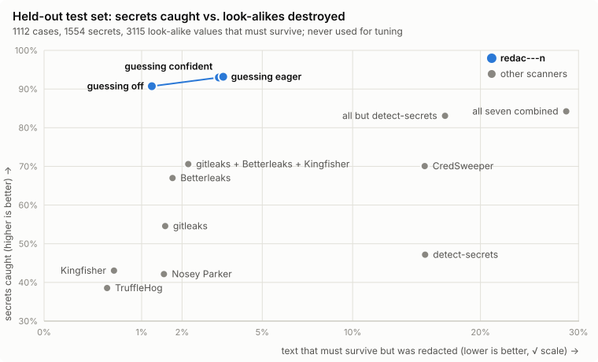
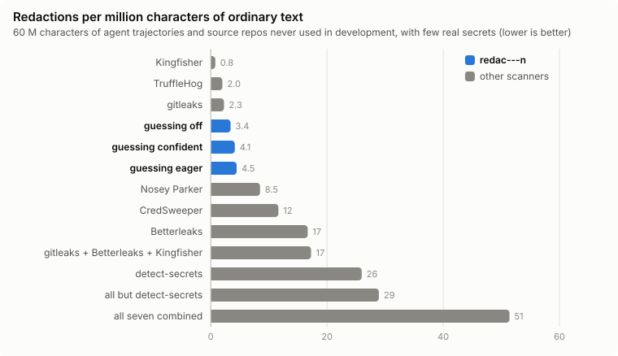

# redac---n

Hide secrets in what your coding agent sends to a model provider.

Agents read `.env` files, run `kubectl get secret`, paste CI logs and run curl with auth headers, and all of it ends
up in the context sent to the provider, any router in between, and your logs. redac---n finds the secrets in that
text and replaces them with placeholders, and leaves alone the commit SHAs, digests, IDs and code the agent needs to
keep working.

TypeScript, no dependencies, no Node-only APIs: it runs on Node 20+, Bun and in the browser.

```sh
npm install redac---n
```

```ts
import { Redactor } from "redac---n";

const redactor = new Redactor();

redactor.redact("DATABASE_URL=postgres://app:Hx7mQ2pL9vRt@db:5432/app\nSALT=k2Lm9Qx", { hint: { command: "cat .env" } }).text;
// DATABASE_URL=postgres://app:[REDACTED password #a794f2]@db:5432/app
// SALT=[REDACTED secret #48712e]   ← the hint says this is a .env file; without it, a 7-character SALT would stay

redactor.redactValue(messages).value; // a whole Anthropic or OpenAI message list, before you send it
```

**[Try it in your browser](https://kendell.dev/redac---n/):** paste a tool's output, give the command or file it
came from, and see what would be sent. The library runs in the page, so nothing you paste leaves it.

## How well it works



On a held-out set of realistic agent output (1,112 cases, never used for tuning), redac---n catches **92.6%** of
secrets and destroys **2.9%** of the values that look like secrets but aren't. The best combination of existing
scanners we found catches 70.6% and destroys 2.2%; all seven together catch 84.2% but destroy 28.6% of the
look-alikes.

| | secrets caught | look-alikes destroyed |
|---|---:|---:|
| **redac---n** (default) | **92.6%** | **2.9%** |
| redac---n, `guessing: "off"` | 90.5% | 0.9% |
| gitleaks + Betterleaks + Kingfisher | 70.6% | 2.2% |
| all seven scanners combined | 84.2% | 28.6% |
| CredSweeper, the best single scanner | 70.1% | 15.2% |



On ordinary text with almost no secrets in it (agent trajectories and repositories it never saw), it redacts less
than Betterleaks, CredSweeper, Nosey Parker and detect-secrets; the scanners that redact less catch 39–55% of
secrets. Each bar is split by what was redacted, every tool's redactions sorted by one rule
([eval/shapes.ts](eval/shapes.ts)): most of what Betterleaks and Nosey Parker hide is ordinary words, most of what
CredSweeper hides is hex (hashes and IDs), most of what detect-secrets hides is other values such as base64 digests,
and about half of redac---n's is credential-shaped. It can also
do something they can't: told which command or file the text came from, it reads what `cat .env` printed as a secret
file, and knows that `cat .env | wc -l` printed only a number.


[CredData](https://github.com/Samsung/CredData) is labelled lines from public repositories, sorted here into the same
kinds. The top row is its dev split, the repositories the fixes were made on; the bottom row is its test split, which
none of them saw. On the test split redac---n catches more than any other scanner but CredSweeper in every kind, and
hits fewer false values than the other six combined: 88% of credential-shaped secrets for 6.6% of the false values
there, against 75% and 14%. CredSweeper is drawn apart because CredData's lines come partly from it and its model is
trained on CredData's labels.

It isn't a guarantee: about one secret in fourteen still gets through, mostly short values with no name or format
next to them. See [what it misses](#what-it-misses).

<details>
<summary>Every test set, and how they're scored</summary>

**Scoring.** A secret counts as caught only if no run of half its length (at least 8 characters) survives. A
look-alike counts as destroyed if it doesn't survive exactly. Ordinary text has almost no secrets, so every
redaction there counts as a false one.

**Held-out sets** were written blind, by agents that never saw the code, and scored before anyone looked at them.
Held-out 1 is scored only as totals, and its failures are never looked at. Each later set was scored once, blind,
and then became development data. Secrets caught / look-alikes destroyed at that blind scoring:

| set | redac---n | `guessing: "off"` | gitleaks + Betterleaks + Kingfisher | best single other scanner |
|---|---:|---:|---:|---:|
| Held-out 1: 1,112 cases over 104 kinds of output | 92.6 / 2.9 | 90.5 / 0.9 | 70.6 / 2.2 | CredSweeper 70.1 / 15.2 |
| Held-out 2: 848 cases from blind template writers | 86.8 / 5.7 | 78.3 / 3.7 | 60.3 / 5.1 | CredSweeper 65.7 / 20.1 |
| Held-out 3: 450 cases, mobile, ML, IoT, enterprise stacks, other CI vendors | 85.5 / 7.4 | 78.5 / 3.2 | 64.0 / 4.8 | CredSweeper 69.4 / 21.0 |
| Held-out 4: 478 everyday agent sessions, issue and PR threads | 90.4 / 1.9 | 86.7 / 0.7 | 66.2 / 3.6 | CredSweeper 74.1 / 20.4 |
| Held-out 5: 352 session logs as stored or sent (Claude Code and Codex JSONL, API request bodies) | 95.3 / 1.7 | 90.7 / 0.1 | 69.5 / 1.1 | CredSweeper 84.4 / 28.7 |
| Held-out 6: 112 cases from regional clouds and payment APIs | 93.2 / 9.3 | 78.9 / 5.8 | 61.7 / 3.1 | CredSweeper 73.7 / 18.1 |
| Held-out 7: 305 cases from databases, queues, observability, build tooling | 93.4 / 8.5 | 85.1 / 3.8 | 69.6 / 3.1 | CredSweeper 67.5 / 19.8 |
| Held-out 8: 261 cases from data and analytics tooling | 89.0 / 1.5 | 83.7 / 0.8 | 67.9 / 1.8 | CredSweeper 72.4 / 16.7 |
| Held-out 9: 300 cases from the AI and agent ecosystem, JVM and .NET business apps, and SaaS integrations | 94.0 / 7.9 | 89.8 / 4.0 | not run | not run |
| [SlotGuard](https://github.com/illinoisdata/SlotGuard): 200 agent sessions, 852 planted values (652 credentials, and 200 email addresses this library leaves alone) | 62.6 / 0.0 | 53.1 / 0.0 | 29.2 / 0.0 | CredSweeper 46.9 / 0.0 |
| [ProwlBench](https://github.com/Lercas/prowlbench): 7,491 secrets in code, tickets, logs and chat in eight languages; 7,375 "secret-free" snippets, some with values under credential names that this library hides by design | 89.4 / 12.5 | 78.6 / 7.8 | 59.1 / 8.7 | detect-secrets 63.8 / 19.1 |

Other measurements; where a set was first scored blind, that score comes first:

| set | result |
|---|---|
| Development sets (4,550 cases, 6,942 secrets, 18,932 look-alikes; held-out 2–9 among them) | 95.6% caught, 1.4% destroyed; 95.5% and 1.4% when each case is wrapped in an Anthropic or OpenAI transcript and passed to `redactValue` |
| [CredData](https://github.com/Samsung/CredData) test split (real lines from public repositories) | 82.8% caught and 3.2% of non-secret lines hit, blind; now 83.9% and 3.5%. On the dev split it was tuned on, 91.4% and 1.8%: the gap shows how much of the tuning doesn't carry over to new repositories |
| Six more ordinary-text sets (new repositories, trajectory shards, donated agent sessions from [Trace Commons](https://huggingface.co/datasets/trace-commons/agent-traces), agent pull requests from [AIDev](https://huggingface.co/datasets/hao-li/AIDev), repositories that handle credentials) | 5.5, 4.1, 5.6, 22.5, 17.0 and 4.8 redactions per million characters, blind (the last two hold AWS signatures in presigned URLs and recorded OAuth test runs with real tokens) |
| [GitLab's secret-detection rules](https://gitlab.com/gitlab-org/security-products/secret-detection/secret-detection-rules), each rule's examples | 81.4% of 2,038 caught and 23% of 168 negatives hit, blind; now 88.0% and 15% |
| Credential-handling code with no credentials ([ICSME 2026](https://doi.org/10.5281/zenodo.22942243), 5,903 snippets) | 4.6% of snippets hit, blind; now 2.0%, mostly passwords written into the code |
| [levainbot/fp-corpus](https://github.com/levainbot/fp-corpus): log and build output, 85 planted values | 79 caught and 3 of 116 clean sections hit, blind; now 81 (the four missed: an email address, two card numbers and one key) and 4 of 116 |
| Issue-report secrets ([Zenodo](https://doi.org/10.5281/zenodo.17430335)) | 76.6% caught, 3.1% destroyed |
| Speed | about 2 million characters a second on one core, synchronous (a 1 MB first send blocks for about half a second: use a worker for big bodies) |

**Other scanners** ran with their defaults and no network verification, on the same files: gitleaks, Betterleaks,
Kingfisher, TruffleHog, Nosey Parker, detect-secrets and CredSweeper (`eval/baselines.py`). Each case was a file,
named whichever way scored better for that scanner: all `.txt`, or an extension from the case's context (`.env`,
`.json`, `.py`). redac---n got the case's command or path as a hint, as an agent harness would give it. Part of the
measured loss is labels that disagree with this library's policy (see
[what it keeps on purpose](#what-it-keeps-on-purpose)).

`eval/HELDOUT.md` has every blind score and what each set led to. [Why each layer is there](docs/layers.md)
measures what each detector adds and costs.

</details>

## Use

```ts
const redactor = new Redactor({
  known: [{ value: stripeKey, label: "Stripe key" }], // values you hold: hidden wherever they turn up
});

redactor.redact(text, { hint }); // { text, findings }
redactor.redactValue(messages); // { value, findings }: every string in a JSON value
redactor.stream({ hint }); // { write(chunk), end() }: each returns redacted text ready to pass on
```

**Give it a hint whenever you can.** A hint says where the text came from, which changes what it means:

- `{ command: "cat .env" }`: the shell command that printed it. It's read with a real shell parser, so
  `cat .env | nl` and `python3 -c "print(open('.env').read())"` print the file, while `cat .env | wc -l`,
  `cut -d= -f1 .env` and `sed -i … .env` don't. `gh auth token`, `op read` and `openssl rand -hex 32` print a
  credential.
- `{ path: "config/credentials.json" }`: the file it was read from.
- `{ secretFile: true }`: your own rules say it's a secret file (from a configured secrets directory, say).

In a secret file, every value under a credential's name and every bare token is hidden, whatever it looks like;
paths, references, URLs without passwords, sentences, booleans and numbers stay.

**Guessing.** Every rule always runs; `guessing` only sets how hard a model guesses at random-looking tokens with no
name or format next to them. `"confident"` (the default) takes the ones it's sure of; `"off"` makes no guesses, for
fewer false hits and lower recall; `"eager"` takes less certain ones too. Inside a secret file the same model always
runs, whatever `guessing` says, but there it isn't guessing whether the text holds secrets (the hint already says
it does): it sorts the file's values under neutral names into generated ones, which are hidden (`SALT=k2Lm9Qx`), and
settings, which stay (`PORT=8080`). [How it guesses](docs/guessing.md) explains the model and how it was measured.

**Placeholders** look like `[REDACTED Stripe key #3f9a1c]`. The tag is a keyed hash of the value, so the model can
tell when two placeholders hide the same secret, but nobody without the key can test guesses against it. One value
written different ways (URL-encoded, shell-escaped, JSON-escaped) gets the same tag and kind everywhere it appears.
JSON stays valid, and redacting already-redacted text changes nothing. The key is random for each Redactor: pass
`fingerprintKey` to keep tags stable across restarts (for a prompt cache, say), and keep it as secret as the
values. The kind can depend on the text (`password` in one place, `secret` in a secret file). Pass `placeholder` to
use your own format.

**More:**

- `detect(text, { hint })` returns the findings without changing the text (for an audit log, say). The findings
  are yours to change.
- `fromEnvironment(process.env)` collects an environment's secrets as known values: variables with credential
  names, vendor tokens under any name, and passwords inside URLs.
- `learn(text, { hint })` remembers what it finds, so it's hidden wherever it shows up later. It returns how many
  values were new.
- `addKnown(value, label)` adds one value. Values too ordinary to hide everywhere are refused (it returns false):
  under 6 characters, numbers of up to 8 digits, letters-only values under 14 characters, values with no letter or
  digit, and one character repeated.
- `hashes: "hide"` hides password hashes too (they're kept by default).
- The standalone `redact(text, options)` export uses a throwaway Redactor: nothing is remembered, and tags are
  random.

### Transcripts

`redactValue` takes a whole request body. Each tool result is judged with the command or path of the tool call that
produced it, matched by call ID, and content a tool writes to a file is judged as that file. IDs, roles, model
names, signatures and images are left alone. Base64 documents with a text media type are decoded and scanned.
Values are redacted as `JSON.stringify` would send them. Pass the parsed value, not its JSON text: `redact` on a
serialized conversation reads the strings in it, but can't match a tool's result to its call, so what `cat .env`
printed is judged without its command.

It learns before it redacts: a secret found once (`API_KEY=…` in a `cat .env`) is hidden everywhere in the
conversation, including earlier turns and wherever the model repeats it, and in whatever this Redactor redacts
later. Pass `{ learn: false }` to keep that to this call. A Redactor remembers what it found in each text, so
re-sending a growing conversation only costs the new turn, unless that turn holds a secret it hadn't seen: then the
history is scanned again to hide it there too. (This memory is capped at 16 M characters of text, plus the values
it holds.)

Anthropic signs `thinking` blocks. One that quotes a secret the model saw is redacted like any other text, and its
signature then no longer verifies, so a request continuing that turn is rejected: a failed request instead of a
leaked secret. Blocks with nothing to hide are left as they are. Pass `{ thinking: "keep" }` if you'd trust the
provider with those secrets anyway.

`stream()` releases text in batches once it's at least 32 K characters behind the newest chunk (`holdback`, at
least 8 K), so a secret split across chunks is never released half-redacted. Nothing comes out until about 64 K
characters have arrived, so it suits long tool output better than a live view; `end()` flushes the rest. An
unfinished line is held until it ends, up to 1 M characters (minified output, a one-line base64 blob). Its output
matches `redact()` on the whole text, except for a single value longer than the holdback, evidence more than 8 K
characters back, and a value named only a holdback's length after it.

## Security model

- **What the provider still sees:** all text that isn't a secret, each placeholder's kind (a format's name,
  `password`, or your label: keep labels free of anything sensitive), and tags that link repeats of one value.
- **One Redactor per user or tenant.** A Redactor holds every value it was given or learned, in plain text, and
  hides them in everything it redacts afterwards. Shared across customers, one customer's secrets and labels would
  turn up in another's redacted text.
- **Learning works backwards.** A secret found in turn 5 is hidden in turns 1–4 the next time the history is
  redacted. The provider already saw what was sent before, and the earlier turns now read differently, which
  invalidates a prompt cache from the first changed turn.
- **Hostile text** (a repository or web page the agent reads) can't unhide a value you gave the Redactor or one it
  learned: those are hidden whatever surrounds them. It can teach it a value to hide (`API_TOKEN=<a commit SHA>`
  hides that SHA from then on), and next to a value it doesn't know, it can add context that reads as public, such
  as an `EXAMPLE` marker or a hash's name.
- **Failures close.** If a detector throws, the whole text becomes one placeholder. `redact` throws on input that
  isn't a string: treat a throw as "don't send".
- **Findings carry the secret** (`value`, the secret as a program would read it). Strip it before you log them.
- **Don't put secrets back into the model's tool calls.** A compromised router or an injected instruction could
  send a restored secret anywhere. Let the executor or an egress proxy fill in credentials at run time
  (`$STRIPE_KEY`). An agent that edits files it read through redaction needs its executor to restore that file's
  values when writing it.

## What it finds

Seven detectors propose spans, and one decision stage (`src/policy.ts`) rules on what they propose, the same way
whichever detector found it. Values you gave it and a secret file's contents skip that stage: you, or the file,
already said what they are. Each detector catches secrets the others miss; [why each layer is there](docs/layers.md)
measures what each adds and what each costs.

1. **Values you gave it**, in every encoding output turns them into: JSON-, URL-, shell-, SQL- and HTML-escaped,
   hex, base64 at any offset, and cut short.
2. **542 vendor token formats**: 143 maintained here and 399 from
   [Betterleaks](https://github.com/betterleaks/betterleaks)' catalog (some vendors are in both).
3. **Structure:** private keys (by their DER, under any PEM label), URL passwords, Authorization headers, cookies,
   connection strings, signed URLs, Kubernetes Secrets, CI masks, sign-in links, `.netrc`, and passwords given to
   command-line tools, tool by tool (`mysql -p`, `curl -u`, `docker login -p`; but `redis-cli -p 6379` keeps its
   port).
4. **Names:** values under credential names in every syntax tools print: env files, YAML, JSON, INI, code
   assignments and declarations, flags, XML, setters, calls that take a secret (`jwt.sign(payload, secret)`),
   commands that set one (`setx`, `npm config set`), tables and SQL rows, labels in prose and other languages, a
   name on the line above, a column's header, a list's name, "here's your key:". A name is judged by its words:
   `DB_PASSWORD_PROD` is a credential, `PASSWORD_MIN_LENGTH` and `TOKEN_URL` aren't. References, placeholders,
   types and code stay, and so does a password that's just the user's or the database's name next to it.
5. **Where the text came from:** the output of `cat .env` and other secret files, commands that print a credential
   (`gh auth token`), and secret files written inside the text (a heredoc, a diff's hunks).
6. **Encoded:** base64 and hex (including `xxd` and `hexdump` output), decoded and judged as the text they hold.
7. **Random tokens with no name or format:** a LightGBM model scores each token on how random it is for its length
   and alphabet and on its context, and fixed rules keep what's never a key (hashes, UUIDs, public keys, encrypted
   values, IDs).

Before any of that, text is read the way a terminal shows it (ANSI colours, line continuations, HTML entities,
invisible characters and a viewer's line numbers removed, from `cat -n` or an agent's Read tool), and JSON strings,
Python reprs, percent-encoded text and string literals split in pieces (`"sk-" + "…"`) are decoded or joined and
scanned as what they hold.

## What it misses

- **Short secrets with no name, format or context**, alone in ordinary text, look like any other ID. Random tokens
  longer than 256 characters aren't judged on randomness alone either (they're far more often images and
  certificates): those need a name, a format or a header.
- **Passwords in conversation** with no name next to them ("use Lamp-otter-91Qx"). In issue reports overall, about
  three secrets in four are caught.
- **Shortened values** with `...` in the middle (`sk-abc...xyz`) are taken as a display, not a secret.
- **Keys in forms no rule reads:** a key written as a list of byte values (`22, 53, 50, …`), and formats with no
  rule yet (PASERK keys).
- **Personal data.** It doesn't detect names, email addresses, SSNs, card numbers or postal addresses. Pass the ones
  you know as `known` values: they're matched as written (and escaped), not in other formats (`4111 1111…` doesn't
  match `4111-1111…`), and a one-word name under 14 letters is too ordinary to accept.

### What it keeps on purpose

These are fixed policy, not settings; `hashes: "hide"` is the only switch. To hide one of these values anyway, pass
it as a `known` value: known values are hidden whatever they look like, as long as they aren't too ordinary to accept
(`changeme` is refused; see `addKnown`).

- The stand-ins every common-password list starts with, under a password's name (`password`, `changeme`, `hunter2`,
  `postgres`, `test123`), and a device's default PIN where the text says so. Docs use these far more than configs
  do, and hiding a password an attacker tries first protects little.
- Password hashes, unless you pass `hashes: "hide"`.
- Hex and UUIDs under names that don't say they're credentials: far more often a commit, a digest or an ID than a
  key.
- Encrypted values: SOPS, Ansible Vault, Sealed Secrets, Spring `{cipher}`, JWE, DPAPI. Jenkins' and Maven's `{…}`
  are hidden, since their key sits on the same machine.
- Keys that are public by design: publishable keys (`pk_live_`), Sentry DSNs, Supabase anon keys, Google `AIza`
  keys in client configuration (but not in a server's environment), keys passed to browser and mobile SDKs, Bitcoin
  and NATS public keys.
- Authentication challenges a server sends (`WWW-Authenticate: NTLM …`).
- Test vectors under generic names in files that say they are test vectors (Wycheproof, CAVP).

## Development

`pnpm test` runs the behaviour tests (Node 22.18 or later), and `pnpm check` runs the quality gate.

<details>
<summary>Tests, the quality gate and the evaluations</summary>

- **Behaviour tests** (`test/`, by topic): a few cases per rule or decision, cross-products of credential names,
  syntaxes and value shapes, and checks that long and repetitive inputs take linear time.
- **The quality gate** (`pnpm check`) scores every development set and the 138 regression sets
  (`eval/corpora/regress/README.md`: probes of each rule's edges) against a committed baseline
  (`eval/baseline.json.gz`), and fails on any case that newly leaks, is newly destroyed or is newly slow.
  `scripts/snap.ts` does the same with a sample of ordinary text from the external corpora added.
- **Fuzzers:** `eval/fuzz-secrets.ts` hides random passwords and keys of ten shapes in twelve syntaxes, with values
  up to 5,000 characters; `scripts/fuzz-perf.ts` puts every rule's trigger after long runs of filler and fails on
  any input that takes more than linear time.
- **Evaluations:** `node eval/all.ts` runs the development checks. `node eval/layers.ts` scores each detector alone
  and left out. `node eval/report.ts` scores the held-out set (totals only) and draws the first two charts above;
  `node eval/creddata-chart.ts` draws the CredData charts (its header gives the steps before it).
- **The demo** (`site/`): `pnpm site` builds it into `_site/`, and every push to `main` deploys it to GitHub Pages
  (`.github/workflows/pages.yml`).
- **Corpora:** the third-party corpora live outside the repository (`$REDACT_CORPORA`, by default
  `~/Downloads/redact-corpora`); on a fresh clone, the scripts score `eval/corpora` and skip the rest. The corpora in
  the repository are gzipped, because the fake credentials in them would otherwise look like real ones to secret
  scanners, GitHub's push protection among them.
- **The model** is trained on public text and synthetic keys, never on the evaluation sets. That corpus isn't
  published; the training scripts are, and train a model of the same design on yours
  ([How it guesses](docs/guessing.md#rebuilding-the-model)).

</details>

## License

MIT. The imported formats come from Betterleaks and the BIP-39 wordlist from Bitcoin's BIPs, both MIT; see
`THIRD_PARTY_NOTICES.md`.
