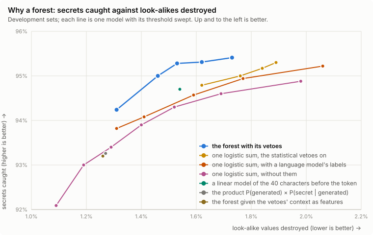

# How redac---n guesses

Most secrets come with evidence: a credential's name (`DB_PASSWORD=`), a vendor's format (`ghp_…`), a structure
(a PEM block, a URL's password), a value you gave it, or the command that printed it (`cat .env`). What's left are
random-looking strings with none of that next to them: the key passed to `Client("…")`, the token in a neutral
`X-Lumen:` header, a value pasted into chat. Deciding those is guessing, and the `guessing` option sets how much of it
the library does. This page explains how the guessing layer works, how well it does, and why it's built this way.
[Why each layer is there](layers.md) compares it with the other detectors.

## The problem

A candidate is any run of 16 or more token characters (letters, digits, `+/=_-`). Deciding whether it's a secret
takes two questions, and each needs different evidence:

1. **Did a machine generate it?** Keys, hashes, UUIDs, nonces and certificate data are generated; identifiers
   (`get_all_subclasses`), words, paths and versions are written by people. The token itself answers this: how much
   it reads like an identifier to a character model trained on real code (`charlm.ts`), how its entropy compares
   with a random string of the same length and alphabet (`random.ts`), how often it switches between cases and
   digits, and how long it is.
2. **If so, is it a secret here?** Commit hashes, digests, object IDs, publishable keys and API keys are all random.
   Only the context tells them apart: the name it's under (`api_key=` versus `sha256:`), words nearby ("publishable",
   "anon", "trace"), where it sits (a column of IDs, a file listing, a SQL row, a URL path), or a function it's
   passed to.

Some facts settle a candidate whatever the answers: an encryption wrapper (`ENC[…]`, `{cipher}`), a public key's
structure, a file's magic number in base64, a checksum that verifies, an API object ID's format (`toolu_…`,
`vpc-0bddc3783c4aae5fc`).

## How it works

`src/unnamed.ts` first reads each candidate's context (`src/context.ts`): the name it's under, the syntax around it
(an assignment, a flag, a header, a call, an item in a named list), and the words on its line. A token whose run
starts with `_`, `-` or `+` is read from where the run starts, so `Client("_abc…")` is still a call. Then three
things decide it:

- **Vetoes**: about 60 hand-written rules (72 in all) that set a candidate aside. Seven of them are facts
  (encryption, public keys, AWS unique IDs, hash prefixes, key IDs after the option that takes them), shared with the
  decision stage that reviews every detector's findings. The rest judge how a token looks (hex, a UUID, an
  identifier, a slug, words) or its context (a hash's or an ID's name, a file listing, a SQL cell, a path).
- **A LightGBM forest** (300 trees, 43 features) scores whatever the vetoes let through. Most features describe the
  token; a few describe its context coarsely (a credential word on the line, the kind of name, the syntax).
- **A threshold**, set by `guessing`: 0.8 for `"confident"` (the default), 0.5 for `"eager"`, and none at all for
  `"off"`, which turns the layer off.

Inside a secret file (a hint, or a secret file written inside the text) the layer always runs at 0.5, whatever
`guessing` says. There the hint has already said the text holds secrets, so the model's job is different: it sorts
the file's values under neutral names into generated ones, which are hidden (`SALT=k2Lm9Qx`), and settings, which
stay (`PORT=8080`, a hostname, a log level).

The forest is good at the first question and crude at the second; the vetoes carry most of the context, as
exceptions.

The forest is trained by `scripts/unnamed-data.ts` and `scripts/train-unnamed.py`. Its negatives are real candidates
from public repositories and agent trajectories. Its positives are random keys placed where keys appear (in many
alphabets and lengths, including standard base64 up to the 172 characters `openssl rand -base64 128` prints). Both
pass through the same vetoes the forest sits behind, so it only learns what the vetoes leave to it. That matters for
hex: the hex veto lets hex through only where a key goes (a credential's name, a handover, a vendor client's call), so
the training data places hex keys in vendor calls too, or the forest would never see one there. Each tree is fitted on
a random 80% of the rows and of the features.

## Measurements

On the development sets (4,250 cases) and 58 M characters of ordinary text (agent trajectories and repositories; the
same corpus the negatives come from):

- **The vetoes do most of the work.** Without them, the pipeline makes 74 redactions per million characters of
  ordinary text instead of 5.4, and destroys 7.9% of the look-alikes in the development sets instead of 1.5%, for
  1.1 points more recall. A few vetoes (hex, identifier-shaped, object IDs, public IDs, hash words, hex groups,
  placeholders, UUIDs) do most of that; the rest matter for the cases they name. They also throw away some secrets,
  mostly hex keys the hex veto mistakes for hashes.
- **Context matters.** Scoring each token without the text around it costs 2.1 points of recall and destroys 2.4% of
  the look-alikes instead of 1.5%.
- **The forest mostly measures randomness.** Five features (two forms of word-likeness, length, entropy, and whether
  the token has a name) account for nearly 80% of its gain. On the hardest candidates, the ones only the forest
  decides, it ranks weakly (AUC about 0.7): a little over half of what it scores above 0.8 is secret, and about the
  same share above 0.995.
- **Its strongest context signal comes from how it's trained.** Real candidates next to a credential word are left
  out of the negatives, because in public text they're often examples or leaked keys. So the forest treats "a
  credential word on the line" as near proof. That's wrong for a publishable key next to "key", but in agent output
  a random string next to `api_key=` is usually a secret: training without that exclusion costs about 2 points of
  recall.
- **The score tracks randomness, not certainty.** The share of secrets rises with the score, from about 5% below 0.05
  to over half above 0.995 on the hardest development cases. In ordinary text, everything above 0.8 adds up to a
  fraction of a redaction per million characters. Scores between 0.5 and 0.8, which `"eager"` adds, are mostly
  look-alikes no veto covers: ETags, ULIDs, `go.sum` hashes.

## Why a forest

Several other designs were built and scored the same way. The cleanest of them factors the two questions: one model
scores how generated the token looks, another how secret its context makes it, and the vetoes about appearance and
context become things the model learns instead of rules. It was built as one logistic sum over about 2,000 named
pieces of evidence, and as a product, P(generated | token) × P(secret | generated, context). For training labels, a
large language model was asked what about 17,000 hard candidates were; it separated them far better than any feature
model (AUC 0.90 against the forest's 0.7).

None of them catches as many secrets as the forest at the same rate of destroyed look-alikes. Moving a threshold
moves a model along its own line, and the forest's line sits above the rest along its whole length. On the held-out
sets, scored once, the best alternative recalled about 0.4 points less than the forest at the same loss.

Why the forest wins, and what would have to change for that to change:

| reason | what it means |
|---|---|
| The training text is public text, not agent output | In public text, 64-character base64 is almost always a line of a PEM body or a blob, so a model that reads context learns that length as evidence against a secret. The forest's simpler "random enough is a secret" is right for agent output. |
| The positives are synthetic | Every key in the training data was placed by a generator, and the readable models learn its habits: an ID's place, or a public word in the name, counts toward a secret because the generator puts keys there more often than real text does. |
| The hardest cases need knowledge | That `serverKey` in a SCRAM block is a derived hash, or that a Segment write key in `api_tokens` is a credential, isn't in the 40 characters around a token. The language model knows it; a small model trained on its labels learns only part of it. |
| What could change it | Real labelled secrets instead of placed ones (the 2,600 the language model labelled are the only real positives any of these models has seen), sign constraints on the context flags the generator distorts, and key lengths in whole bytes in neutral places. |

Other designs that were tried:

| design | result |
|---|---|
| the forest trained on cleaner data (hard negatives kept, key lengths spread evenly) | about 0.4 points less recall; it reads length smoothly and the credential-word shortcut is gone |
| simpler models (a monotone forest of depth 2; an additive model of 6 KB) | 1 to 2 points less recall; the additive model is 20 times smaller and faster |
| predicting the kind of token (secret, hash, ID, public key, encoded, code) | no better separation; calibration on the training data doesn't carry over to agent output |
| giving the forest the vetoes' context as features | it can replace the vetoes about appearance and recovers hex keys where keys go, but recalls 2 points less than the forest with its vetoes |
| a linear model of the 40 characters before the token | ranks better (AUC 0.76) and is calibrated, and learns "public", "id", "state" and "nonce" as evidence against; on its own, about 0.6 points less recall |

On the hardest candidates, random tokens next to credential words, every model sits near 50% precision: telling a
publishable key from a secret one there needs knowledge the text doesn't hold.

## Rebuilding the model

The forest is trained from a corpus of ordinary text (one JSON object per line, `{"src": …, "text": …}`, at
`$REDACT_CORPORA/built/dev.jsonl`):

    node scripts/unnamed-data.ts > train.jsonl
    python3 -I scripts/train-unnamed.py train.jsonl --write src/model-data.ts

The corpus behind the shipped model (634 MB of public repositories and agent trajectories) isn't published: its
sources' licences differ from this one's. With your own corpus the same two commands train a model of the same
design, not the same model. Both steps are deterministic (the random keys are seeded, and so is LightGBM's training,
including its sampling of rows and features), so a given corpus always gives the same model.

The training data passes through the vetoes and the same context reading, so any change to a veto or to how context
is read changes the data, and the model has to be retrained with it. `node scripts/model-chart.ts` redraws the chart
above from the measurements written in it.
